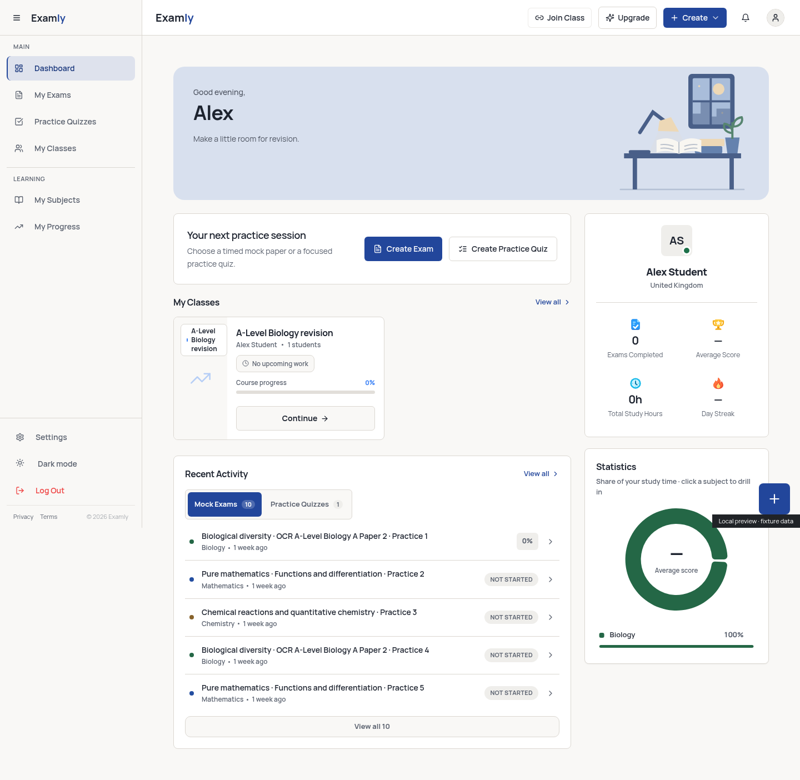
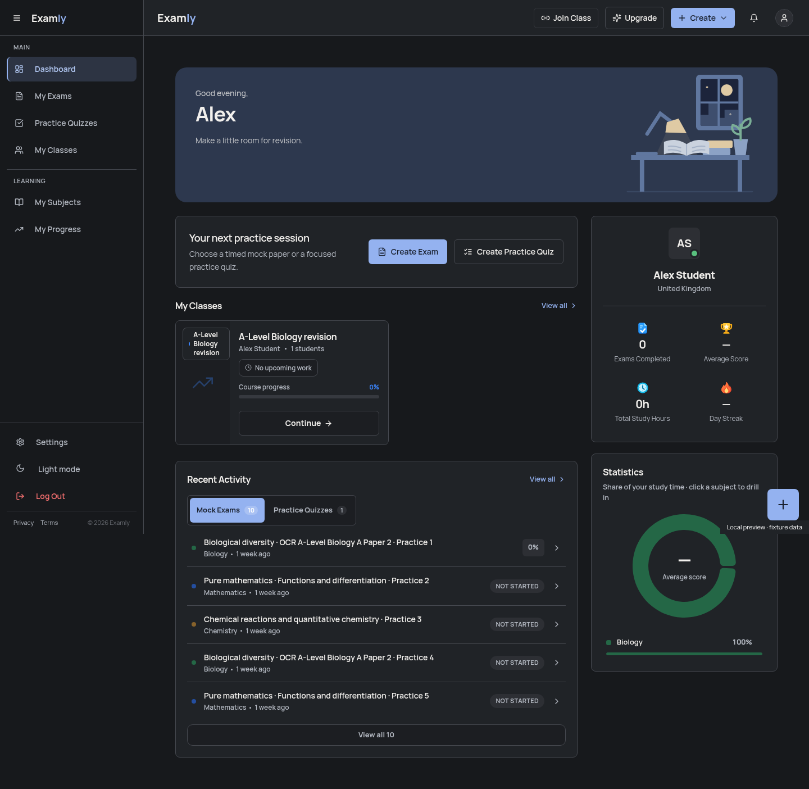
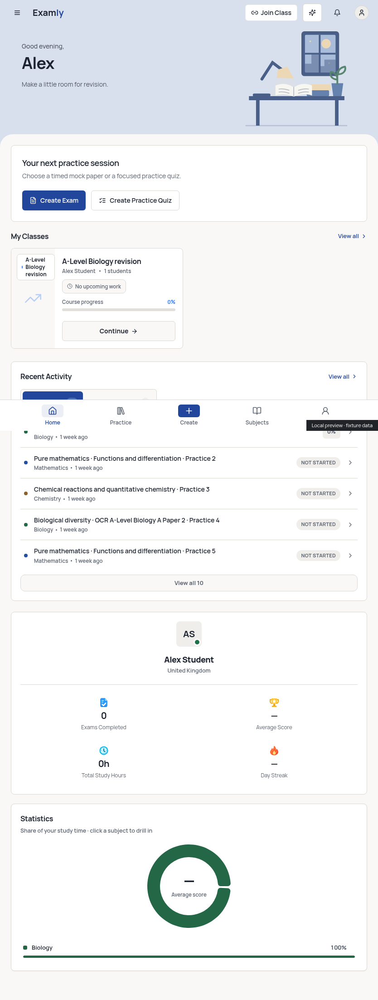
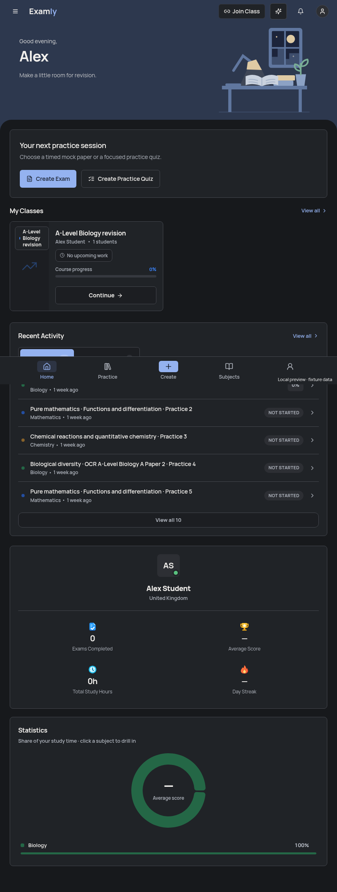

# Home banner layout refinement

Laptop widths (1280px and above) restore the original inset, rounded banner
above both dashboard columns. The top bar and surrounding page use the normal
workspace surfaces again. The profile/statistics column starts below the banner,
beside the create controls.

iPad widths (768–1279px) retain the banner's continuous background into the top
bar and page edges. The content surface below has 28px top corners, matching
mobile. A non-interactive CSS backplate covers the existing content grid without
adding wrappers or changing controls, state or data. Mobile is unchanged.

Morning, afternoon and evening scenes remain available on every layout.

## Screenshots

These show the actual dashboard with an in-memory fixture session. No real
account was used; live Supabase requests were blocked. All figures are fixture
data used only in the local preview.

| Layout | Light | Dark |
| --- | --- | --- |
| Laptop, 1440px |  |  |
| iPad, 834px |  |  |

## Verification

Node 24.19.0, existing dependencies and unchanged lockfile:

- `npm run typecheck`: passed.
- `npm run lint:critical`: passed.
- `npx vitest run src/test/study-welcome-banner.test.tsx src/test/mobile-home.test.tsx --maxWorkers=1`: **15 tests passed in 2 files**.
- `npm run build`: passed.
- `git diff --check`: passed.

Chromium checked **28 viewport/theme/scene combinations**: evening at 320, 390,
600, 768, 834, 1024, 1194, 1280, 1440 and 1920px in both themes; morning and
afternoon at 834 and 1440px in both themes. Checks covered the breakpoint-specific
banner/background treatment, iPad corner styling, laptop card alignment, retained
create controls, text/art separation, contained artwork and horizontal overflow.
The four mobile stat segments remain 58px tall. Long names were additionally
checked at 320, 600 and 834px.

There were no JavaScript, console, certificate or failed-request errors. Google
Fonts responses were HTTP 200, with normal TLS verification enabled. There were
zero live backend requests. This was Chromium viewport emulation; physical
iPadOS/iOS hardware and a real authenticated session were not tested.

Existing build warnings remain: outdated Browserslist data, a Zod comment
annotation and chunks above 500kB. The full test suite and Edge Function bundles
were not rerun for this CSS-only change. No backend, migration, function
deployment or website publication is involved.
