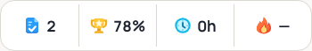

# Dashboard stat icons

Implements the selected **A — Bold & friendly** direction as original inline SVGs:
a blue checked paper, gold trophy, cyan clock and orange flame. No raster sheet,
image service, external icon request or dependency is used at runtime.

The mobile strip keeps four equal segments, its existing 58px overall height,
48px minimum button height, dividers, 17px values and click handlers. Icons are
20px square. Only the icon and value are visible; statistic names remain in the
definition list and accessible button names. Desktop retains its 22px icons,
visible labels and existing profile-card arrangement. Calculations and data
queries are unchanged.

## Local Chromium preview

The actual MobileDashboard, MobileStatsStrip and ProfileCard components were
rendered in an isolated harness outside the repository using existing sample
data. No real account was used, and all Supabase browser requests were blocked.
These screenshots show fixture values, not a student's records.

Light:

Dark:

Checked 320, 390, 768, 1024 and 1440 CSS pixel widths in both themes. All ten
views had no page overflow. Mobile assertions confirmed equal segment widths,
20px icons, unchanged strip height, visually hidden labels and all four original
click handlers. Desktop assertions confirmed 22px icons and visible labels.
Keyboard focus remained available. Final browser checks recorded no JavaScript,
console, certificate or request failures, with zero Supabase requests.

Google Fonts initially failed because Chromium had not received the current
managed proxy CA. The existing saved Start skill's verified-CA initialization
resolved this without changing repository files or disabling TLS verification.

This is browser emulation and a component preview, not a test on physical
iOS/iPadOS hardware or an authenticated production account. No migration,
Edge Function deployment or website publication is required for this change.
