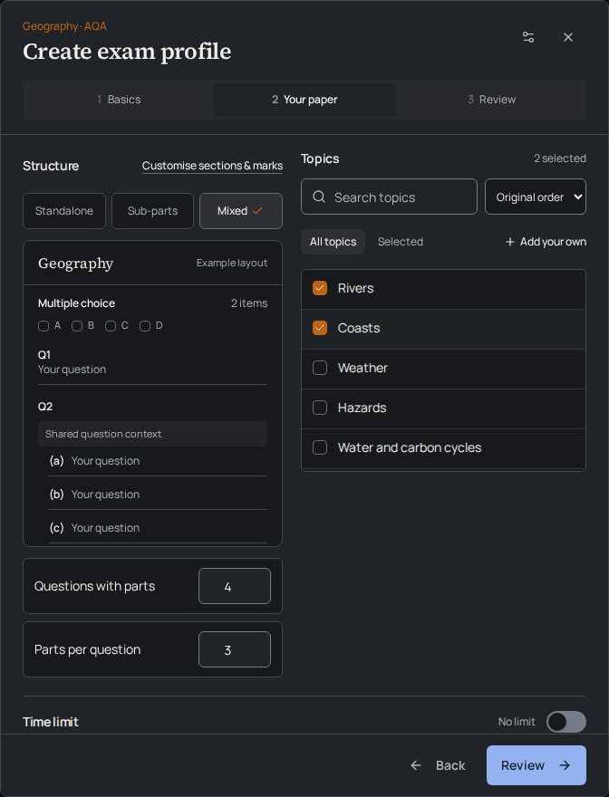
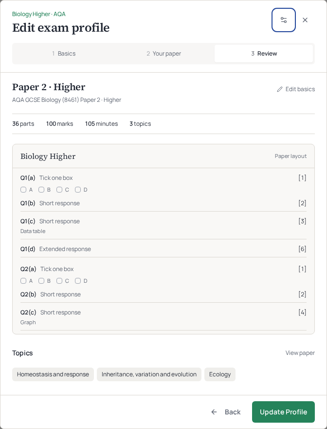
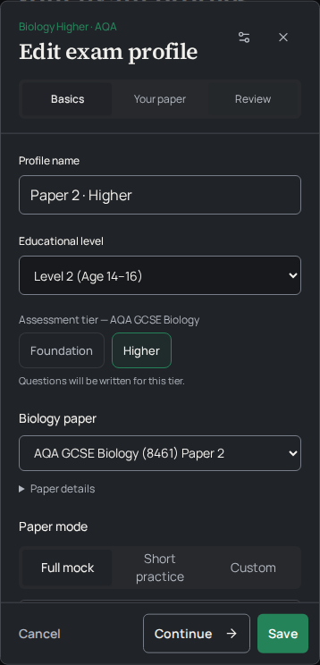
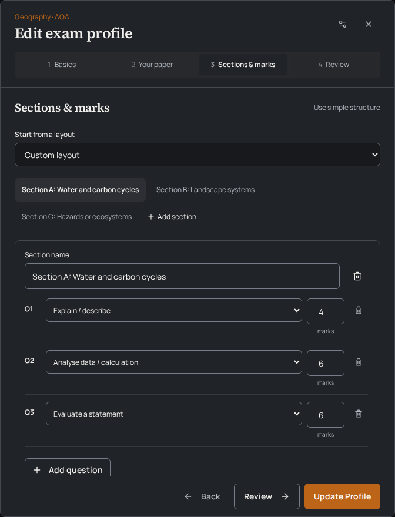

# Exam profile workflow

The profile editor replaces the long settings form with pages inside the existing 672px-wide dialog. Its maximum height remains 88vh. The header, page navigation and footer stay visible; long topic lists and paper plans have bounded previews.

## Pages

| Page | Contents |
| --- | --- |
| Basics | Profile name, educational level, supported course/paper/tier, paper mode, written and multiple-choice counts. |
| Your paper | Standalone/Sub-parts/Mixed structure with a paper preview, searchable and sortable topics, studied content where applicable, time limit. |
| Sections & marks | Optional exact layout editor: subject-specific presets, sections, question purposes, marks and the number of optional questions students answer. |
| Review | Saved paper identity, compact totals, structural preview and topics, with links back to the relevant settings. |

Creation starts at Basics. Editing starts at Review and supports saving a small change without visiting every page. Advanced settings are accessed through the header's sliders icon and displayed within the same editor. Escape returns from Advanced to the current page.

The exact layout feature remains available for Geography, English and other custom papers. Existing question styles, section titles, optional-question counts and mark allocations are retained. It is not shown as an editable alternative for an active guided plan.

## Preset and persistence boundaries

- Guided previews use the actual saved/versioned `PaperPlan`: all planned part numbers, marks, section boundaries, response types and resource requirements. A custom structural preview is clearly labelled Example layout.
- Existing guided topics and duration remain fixed by the plan. Changing the course, tier, paper or mode still follows the existing explicit-application rules.
- The editor retains its existing `onSave` arguments, including course selection, paper contract/version, interactive response formats, reviewed visual policy, studied content and custom settings snapshots.
- Search, sort and filter affect the topic browser, not the selected topics. Custom topics remain selectable and retain the existing owner-scoped topic-library persistence.
- Profile cards and compact rows distinguish editing from exam history and show the saved board, qualification, tier and paper identity. No approval stars or approval status are created by this change.
- Backend functions, generation, marking, quotas, access/release rules, migrations, generated types, dependencies, lockfiles and template fingerprints are unchanged.

## Validation

On Node 24, with the existing `package-lock.json`:

- `npm ci --cache /workspace/.npm-cache` succeeded.
- `npm run check`: frontend typecheck and critical hook lint; 1,771 tests across 109 files; backend identifier validation; 38 Edge Function bundles; production build.
- `node scripts/audit-biology.mjs --json`: 52 template audit entries, all `template_checked`, zero defects.
- `git diff --check` succeeded.

The ten new workflow tests cover attempted-step validation, Back navigation and state retention, exact durations, editing from Review, Advanced settings, Geography layouts/choice counts, fixed guided settings, invalid timing, topic search/bulk deduplication, real plan previews and separate card editing. Existing board/profile tests retain their contract assertions and now navigate the workflow before interacting with settings.

### Browser checks

Chromium mounted the real editor and cards in a temporary fixture with in-memory saves. Checks covered custom profile creation, Mixed structure, checkbox keyboard selection, Advanced changes/Escape, guided Biology review, Geography section editing and light/dark layouts. Desktop was checked at 1440×1000 and mobile at 390×844. Basics, Your paper and Sections & marks had no horizontal overflow. No JavaScript exceptions or browser console errors were observed. The fixture was removed.

Manrope and Source Serif 4 were rendered using the existing Google font files downloaded through a TLS-verified system HTTPS client and fulfilled from a local browser-test cache. No font files or font-loading changes were added to the application.

These browser saves did not use a real account or write to the live database. Paid exam generation and authenticated backend save/load were not performed. Existing warnings remain for stale Browserslist data, the ambiguous Tailwind duration class, test DOM nesting and large production chunks.

## Screenshots

Real components with synthetic profile data; no generated exam content.

## Preview rollout

Merge the reviewed PR into `main` and let the connected Lovable project synchronise and rebuild. This is a frontend change: no database migration or Edge Function deployment is required. Keep the website unpublished. Check one existing guided profile and a custom Geography profile in the authenticated preview after sync, preserving their original settings.
