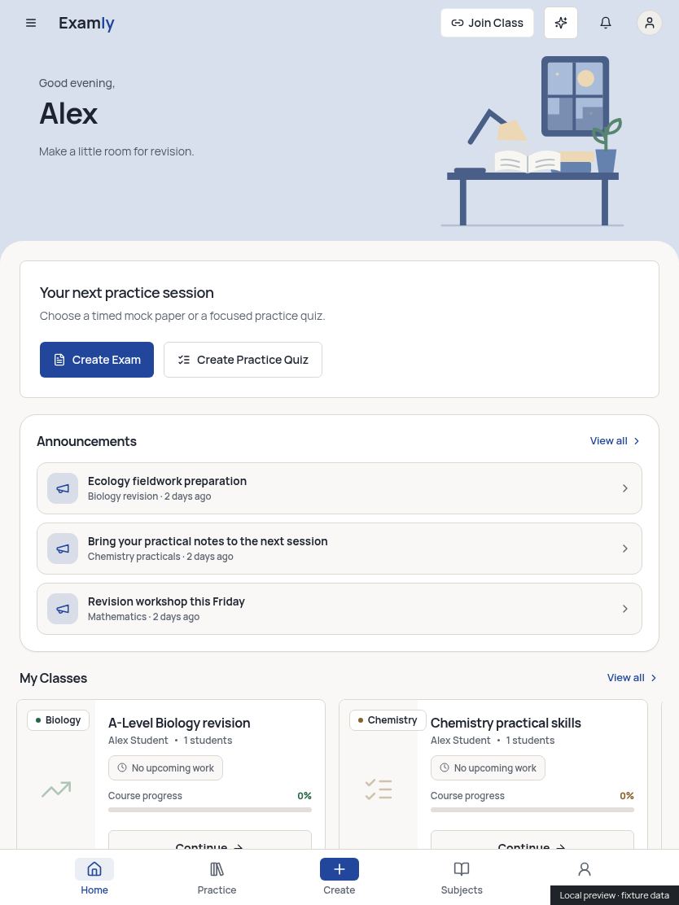
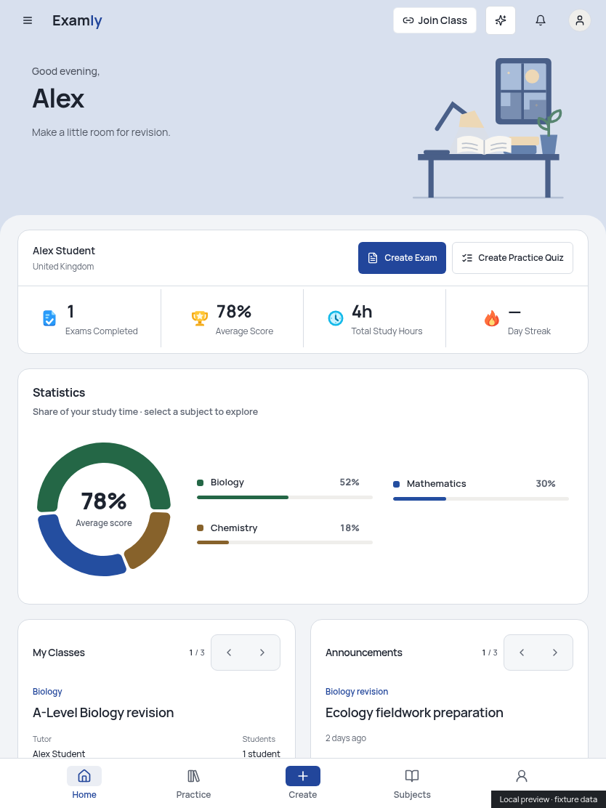
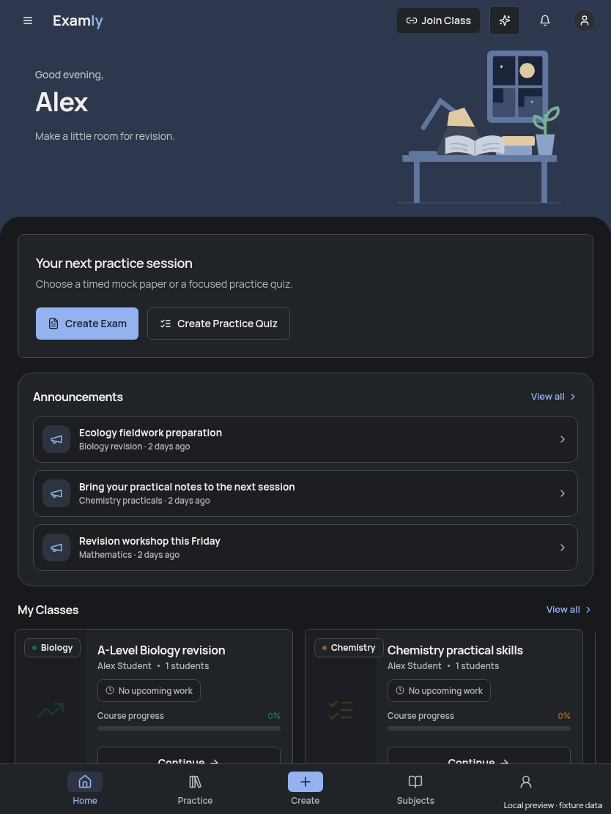
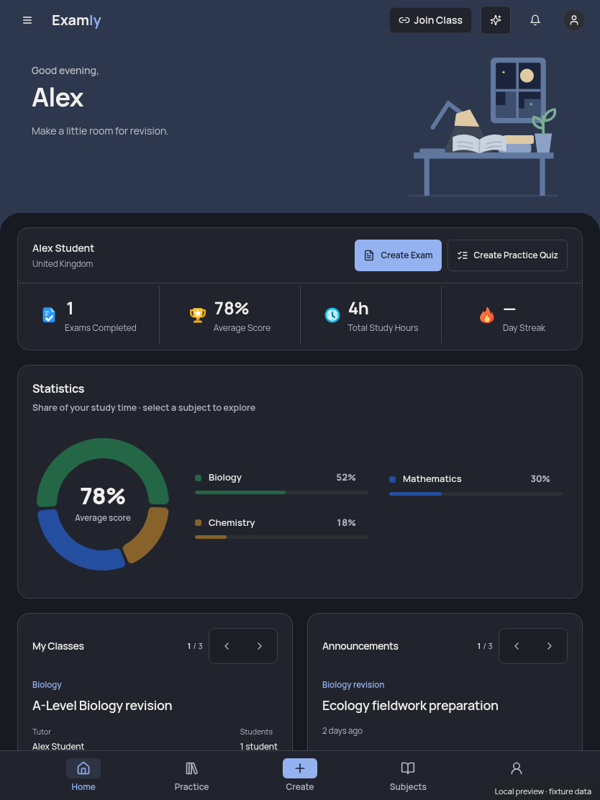
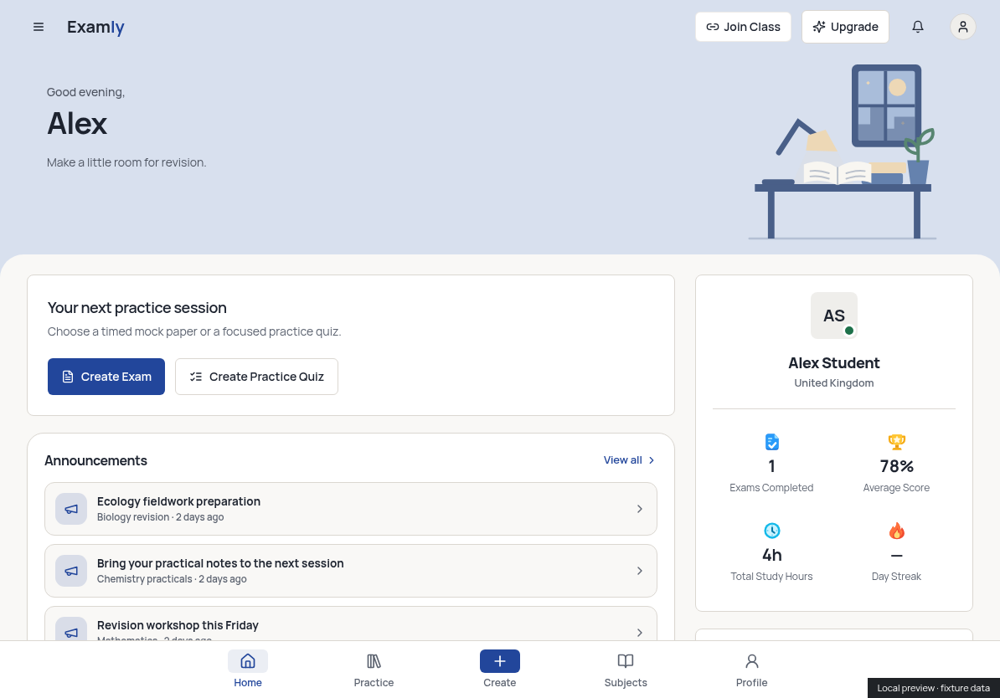
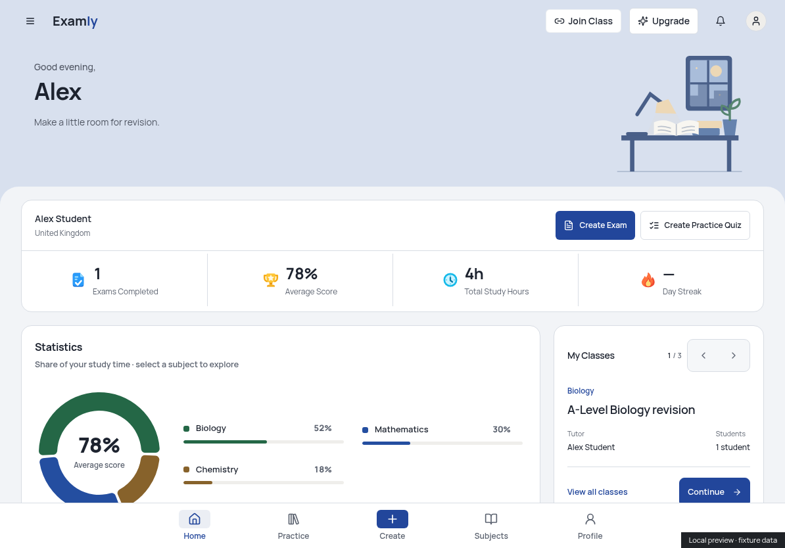
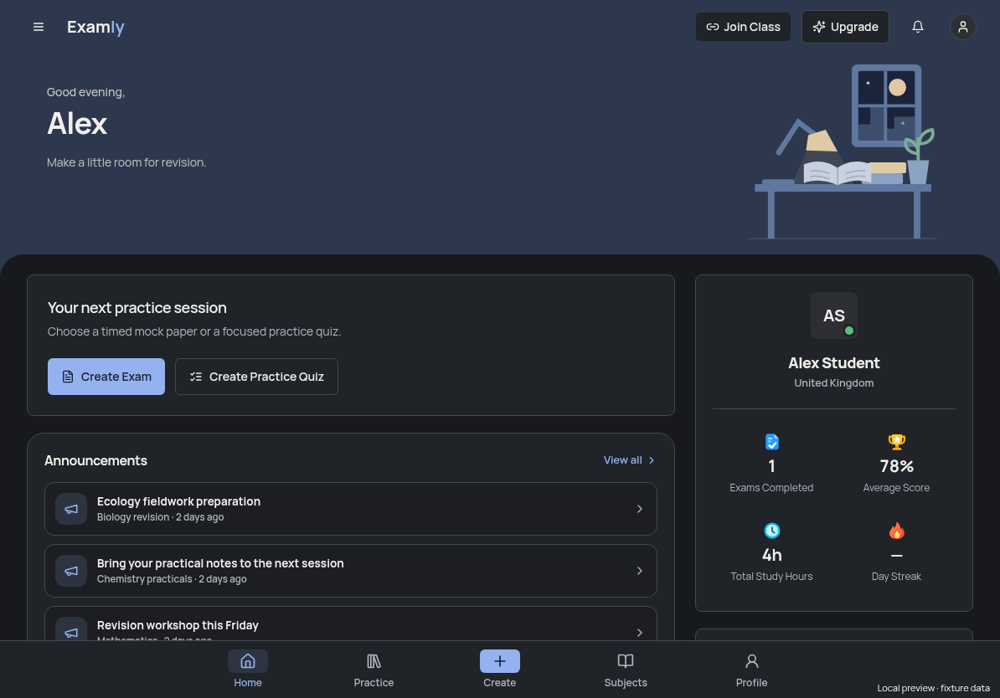
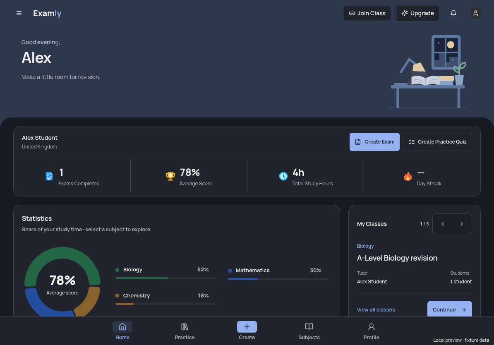

# iPad student Home layout

Branch: `codex/ipad-dashboard-layout`. Started from clean, fetched `origin/main` at `2be3c157cdb2d0355b7bde162198fed71437c8fc` (merged PR #35).

The old tablet dashboard mixed the legacy tall profile card, horizontally scrolling class tiles, announcement list and narrow statistics column. At wide touch widths, some laptop banner rules also applied. This replaces that mix with one responsive composition built from the current laptop cards.

## Layout

| Area | Tablet presentation |
| --- | --- |
| Banner | Existing time-of-day desk scene blended into the top bar, with the rounded content surface below it; the entire illustration fits short landscape screens |
| Summary | Full name/region, compact Create Exam and Create Practice Quiz buttons, and the same four independent stat actions in one horizontal strip |
| 768–1023px | Full-width Statistics, equal-width Classes/Announcements cards, then full-width Recent Activity |
| 1024px+ tablet | Statistics and Recent Activity in the main column; Classes/Announcements stacked in a 320px side column |
| Below 768px / narrow split view | Existing mobile dashboard and four compact summary segments |
| Laptop | Existing layout preserved; all six before/after laptop screenshots were pixel-identical |

Tablet selection follows the existing available-width/primary-pointer convention. Wide coarse-pointer iPads retain the tablet layout; a fine pointer at 1280px+ uses laptop layout. There is no user-agent guessing.

Shared card CSS now supplies both laptop and tablet typography, surfaces, borders, footer actions, pagers, donut/legend layout and activity selector. Tablet pager arrows and actions have at least 44px targets. Profile/account information and all four stat callbacks remain available; duplicate legacy widgets are replaced by the shared cards. The legacy class adapter's placeholder progress/upcoming-work values are not presented as real measurements. The original mobile component is unchanged.

Existing data hooks, queries, score calculations, generation, marking, saved profiles, permissions, quotas, routes and navigation destinations are unchanged. Selections/search/sort continue using the existing account-scoped memory store. Tablet loading skeletons follow the new layout; empty and error states remain visible. Native scrolling, bottom navigation, safe-area padding and the existing keyboard handling remain in place. No custom gestures, dependencies, migrations or backend changes were added. No Edge Functions require deployment.

## Files

Added:

- `src/components/dashboard/StudentHomeLayout.tsx`: shared presentation for the live dashboard and presentational shell.
- `src/styles/home-dashboard-components.css`: existing card styles extracted from the laptop-only media query, preserving laptop rendering.
- `src/styles/tablet-dashboard.css`: tablet grid, blending, touch targets and loading geometry.
- `src/test/tablet-dashboard.test.tsx`: composition/callback and retained-selection regression tests.
- This evidence directory.

Changed:

- `src/components/dashboard/StudentDashboardContent.tsx` and `DashboardShell.tsx`: use the shared layout, preserving their existing data and callback owners.
- `src/components/dashboard/DashboardSummaryStrip.tsx`: optional compact account/actions header for tablet.
- `src/components/dashboard/CreateBanner.tsx`: optional compact presentation using the same two actions.
- `src/components/dashboard/DashboardSkeleton.tsx`: matching tablet skeleton and accessible loading status; existing mobile/laptop skeleton composition retained.
- `src/components/dashboard/SubjectDonut.tsx`: presentation class for a touch-sized Back button.
- `src/styles/laptop-dashboard.css`: retain laptop layout rules while sharing card styles.

## Verification

Node 24.19.0, existing verified installation and unchanged `package-lock.json`.

| Command | Result |
| --- | --- |
| `npm run typecheck` | PASS |
| `npm run lint:critical` | PASS, zero warnings |
| `npm test -- --maxWorkers=2 src/test/tablet-dashboard.test.tsx src/test/laptop-dashboard.test.tsx src/test/mobile-home.test.tsx src/test/home-subject-statistics.test.tsx src/test/study-welcome-banner.test.tsx src/test/mobile-workspace-ux.test.tsx` | PASS, 85 tests in 6 files |
| `npm run build` | PASS |
| `git diff --check` | PASS |

The full `npm run check` chain was not rerun for this focused frontend change. Existing non-blocking build warnings: old Browserslist data, Rollup's Zod annotation and chunks exceeding 500kB.

Chromium used the actual Dashboard/components with an isolated in-memory backend replacement and synthetic **Alex Student** records. No real account login, backend writes or paid model calls occurred; real Supabase requests were blocked and counted (zero). Screenshots contain fixture statistics, not claimed real student results.

- Light/dark touch emulation: 768×1024, 820×1180, 834×1112, 1024×768, 1194×834 and 1366×1024. Narrow split/mobile regression at 744×1112 and 390×844.
- Laptop light/dark regression at 1280×1000, 1440×1000 and 1920×1000; before/after screenshots matched pixel-for-pixel.
- No horizontal overflow, duplicate cards or placeholder course-progress claims. Shared cards align side-by-side in portrait and stack in the landscape rail. The chart stays beside its subject legend. Header blending and top content curves are retained at wide touch widths.
- Last content clears the fixed bottom navigation; pager/actions and topic controls have touch-sized targets. Loading, empty, failed-dashboard and long-title states checked at 834px in both themes.
- Selected class, announcement, activity type, exam profile, topic search and sort survive 834→1194→1366→834 resizing. Keyboard focus, Continue's selected-class destination, both Create destinations and the empty Join dialog checked without submitting anything.
- Final geometry checks confirm the complete desk SVG fits inside its banner and below the top bar at 768/834/1024/1194/1366px in both themes.
- Fonts loaded over normal verified HTTPS with HTTP 200. No JavaScript, console, certificate or unexpected request errors were recorded. The saved system-CA-to-Chromium trust initialization was used; no TLS bypass or certificate files were committed.

These are browser emulation checks. Real iPadOS/Safari hardware, native onscreen keyboard behaviour, screen-reader software and real-account/live backend data remain unverified. The existing keyboard/safe-area mechanisms were retained, not replaced. See `browser-results.json` for recorded checks.

## Before and after

| View | Before | After |
| --- | --- | --- |
| Portrait, light |  |  |
| Portrait, dark |  |  |
| Landscape, light |  |  |
| Landscape, dark |  |  |

Additional evidence: [portrait lower cards](lower-834-dark.png), [landscape lower cards](lower-1194-light.png), [wide touch](wide-1366-dark.png), [narrow split view](split-744-dark.png).

After visual review and green CI, use **Squash and merge** to keep this layout refinement as one commit. Keep the website unpublished; no deployment or migration was performed.
