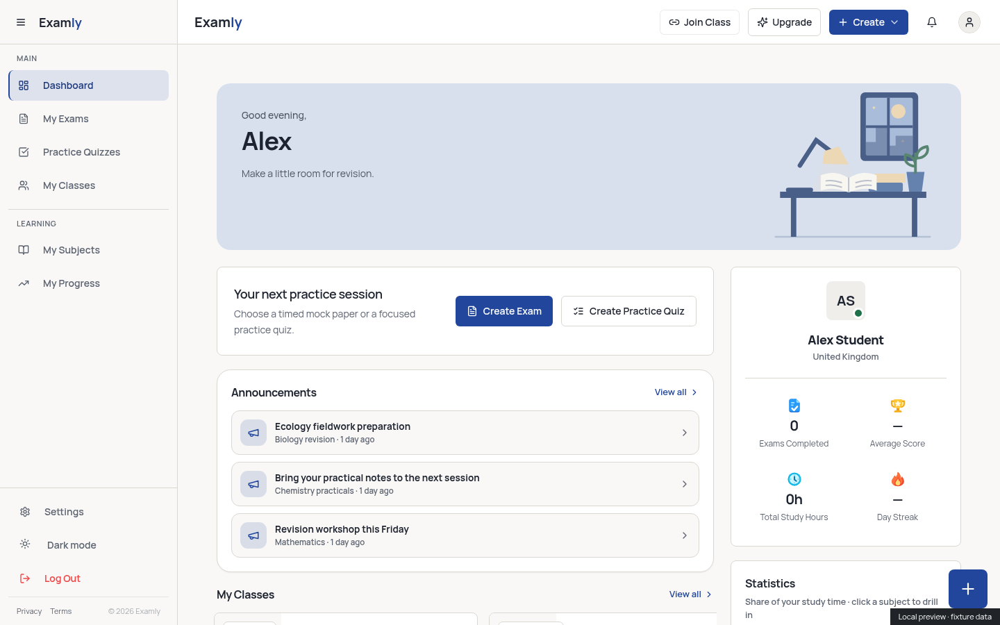
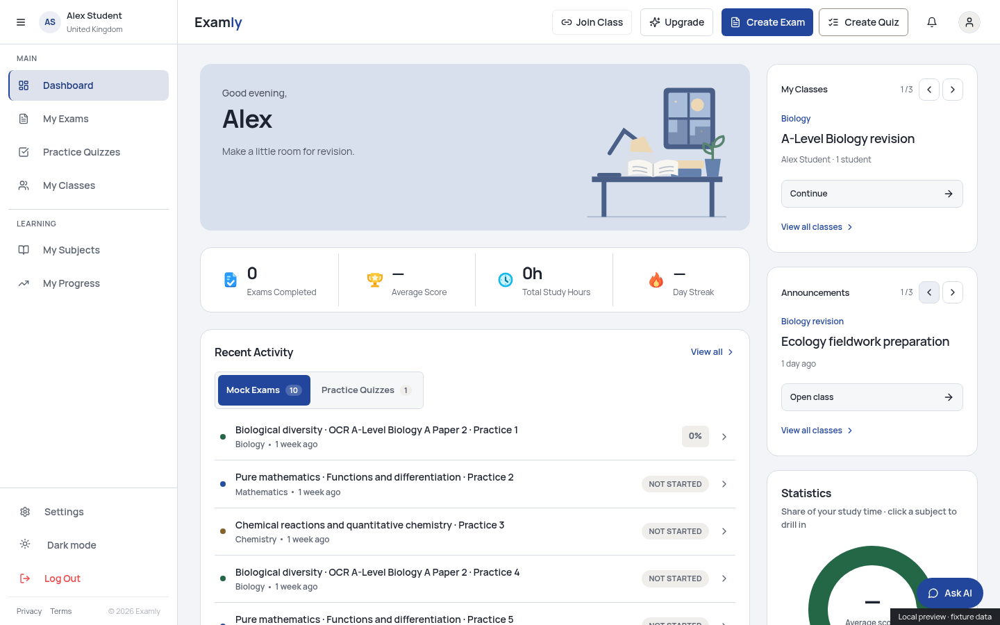
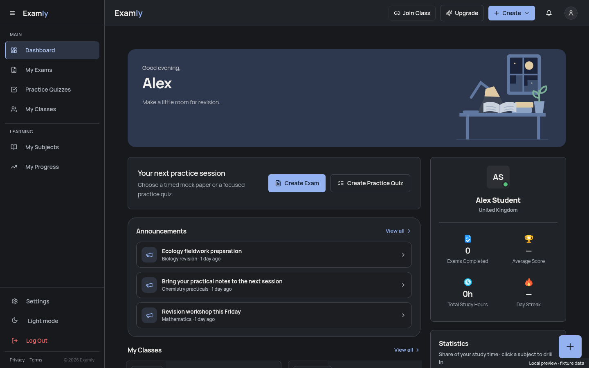
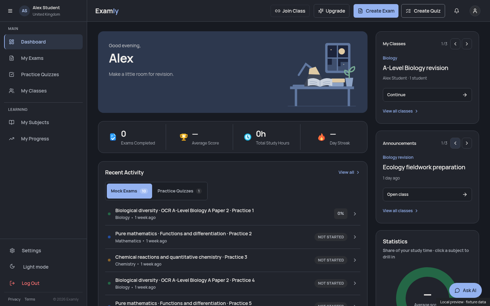

# Laptop student Home

This redesign uses the reference dashboards' hierarchy with Examly's existing
features and data. It applies at 1280px and above with a fine primary pointer.
Mobile and tablet retain their existing layouts, including the blended iPad
header and its curved content surface. Wide touch-only iPads retain tablet
navigation; shared CSS now gives those rules priority over desktop utilities.

## Layout map

| Area | Examly content |
| --- | --- |
| Sidebar header | Initials, saved full name and country/region; collapse control retained |
| Top bar | Examly branding, Join Class, Upgrade, Create Exam, Create Quiz, notifications and account menu |
| Main column, first row | Existing morning/afternoon/evening desk banner |
| Main column, second row | Four equal horizontal segments: Exams Completed, Average Score, Total Study Hours and Day Streak |
| Main column, below | Existing Recent Activity with exam/quiz tabs, row actions and View all |
| Right column, top | One class at a time, with previous/next arrows, real class details and Continue |
| Right column, middle | One loaded announcement at a time, with previous/next arrows and the existing class destination |
| Right column, below | Existing subject statistics and subject/profile/topic drill-down |
| Floating control | Direct Ask AI access, using the existing chat and unread state |

The repeated desktop create banner and floating create menu are removed from
student laptop Home. Tutor/teacher controls retain their existing behavior.
The palette uses a cool neutral canvas, blue accent and consistent white/slate
surfaces in light/dark themes, with 16px card corners and restrained borders.

The four summary values and callbacks, dashboard queries, recent activity,
filters, statistics, marking, permissions and generation are unchanged. The new
sidebar identity reads only existing `user_profiles` and `user_preferences`
fields, filtered to the current owner; it mounts only on laptop with the sidebar
expanded. Query keys isolate accounts, and missing identity has a usable fallback.

The existing class adapter supplies a hard-coded 0% progress and generic upcoming
work text. The new laptop class card omits those placeholders, using the queried
class name, subject, tutor and member count. The adapter and tablet/mobile cards
are unchanged. The announcement query still loads its existing three recent
items; View all classes provides the existing broader destination.

Carousel selections use the existing account-scoped memory store. They survive
leaving and returning, fall back safely when an item disappears, and do not write
records. Empty/single-item lists have disabled arrows and useful empty states.
Existing stats drill-downs and subject chart interactions remain available.

## Screenshots

These are actual Chromium renders using the same local, synthetic fixture data
for the clean `dfb2a2f9` baseline and the redesign. No real account was used.
The charts are captured separately after scrolling them into view.

| 1440px laptop | Before | After |
| --- | --- | --- |
| Light |  |  |
| Dark |  |  |

Subject card: [light](chart-light.png), [dark](chart-dark.png).

## Verification

Node 24.19.0; dependencies and lockfile unchanged.

- Type check and critical lint: passed.
- Focused dashboard/navigation/banner tests: **73 passed in 4 files**, including
  **8 new tests** for independent stat actions, carousel switching/restoration,
  empty/deleted items, owner-scoped identity and read failures. Final targeted
  rerun: **8/8 passed**.
- Full suite, `npm test -- --maxWorkers=2`: **2107 passed, 1 failed, 12 skipped**
  across **128 passing / 2 failing files**. A PGlite `beforeAll` timed out at
  `supabase/tests/generation-context-db.test.ts:49`; an unchanged tutor reply
  recovery test could not find its textbox within its wait. Both affected files
  were rerun serially with the original timeouts: **14/14 passed**. All **2120
  distinct tests** therefore passed across these runs; the initial complete run
  did not pass in one invocation. No tests or validation rules were weakened.
- Production build and diff whitespace check: passed.
- Chromium: **18 viewport/theme/state checks** at 390, 834, 1194, 1280, 1440 and
  1920px, in light and dark themes, with populated, empty, loading and error
  states. Two additional **1366px touch-tablet** checks retained tablet navigation
  and excluded the laptop summary/actions. Four settled chart/layout captures
  cover 1280 and 1440px in both themes.
- Verified one visible create action for each activity, their original routes,
  AI panel opening/closing without sending, sidebar collapse, carousel switching,
  equal summary segments, retained iPad corners/mobile dimensions and no horizontal
  overflow. Final browser runs had no JavaScript, console, certificate or failed
  request errors; Google Fonts HTTP 200 and zero live backend requests.

The saved startup's managed proxy CA was initialized in Chromium's trust store.
Normal TLS verification remained enabled. Existing build warnings remain:
outdated Browserslist data, a Zod comment annotation and chunks above 500kB.

Physical iOS/iPadOS hardware, real authenticated sessions and real AI responses
were not tested. Edge bundles were not rerun: no Edge Function, database schema,
migration, dependency, live record, exam contract or backend behavior changed.
Nothing was deployed or published. Review the screenshots and use **Squash and
merge** after green CI; no Edge Function deployment is needed for this frontend PR.
