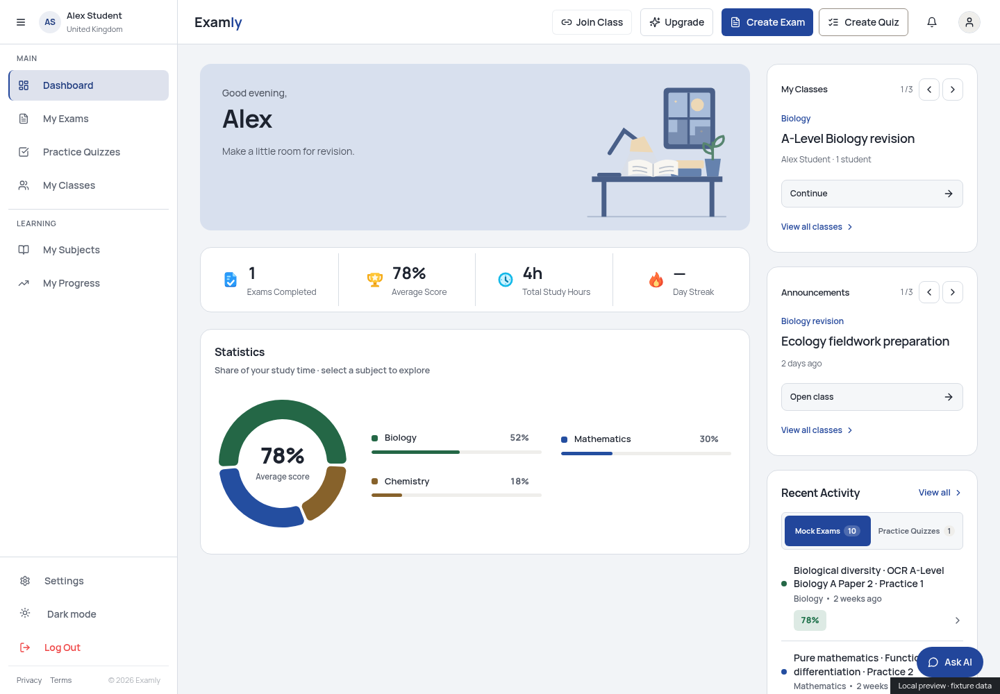
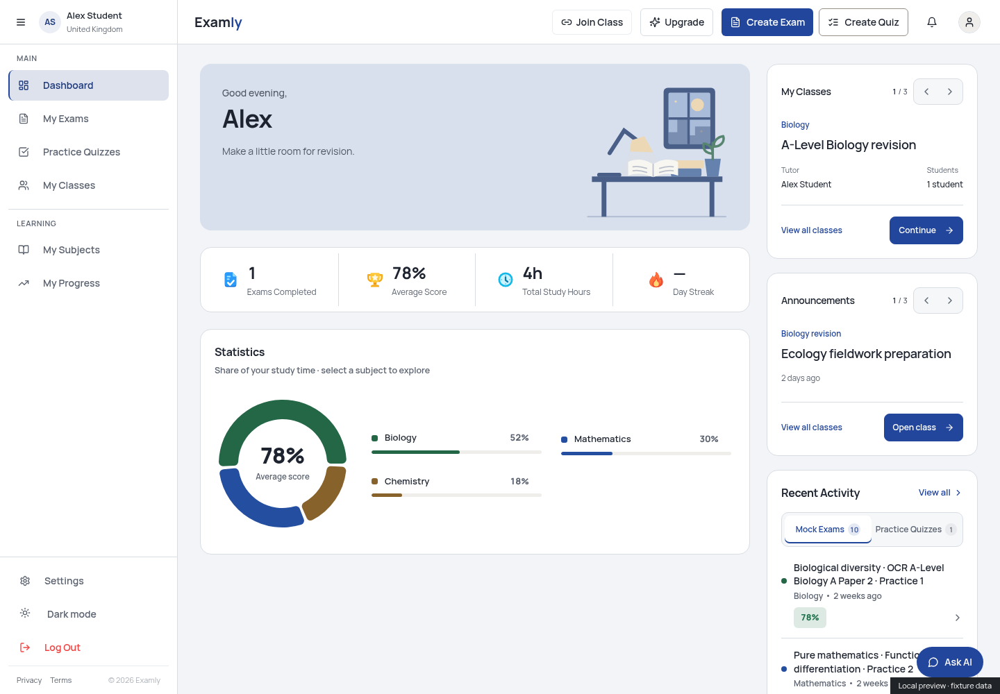
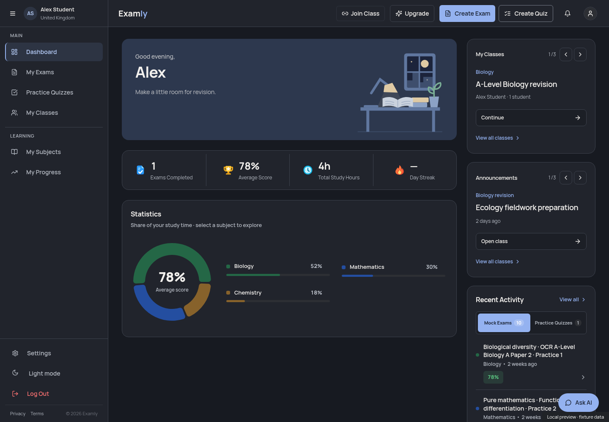
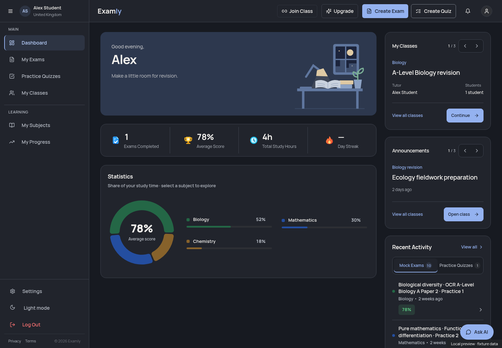

# Laptop Home cards and activity selector

Starting point: clean, fetched `origin/main` at `b6be6d7890c941f4317ba6548e9aebb12eaa132c` (merged PR #34). Branch: `codex/laptop-home-card-polish`.

## Presentation changes

- **My Classes:** clearer section/title/subject hierarchy, separate Tutor and Students fields, a restrained paired arrow control with position count, and an aligned footer with secondary View all classes and primary Continue/Join a class actions.
- **Announcements:** matching hierarchy, spacing, pager and footer treatment, with the source class and timestamp secondary to the announcement title. Long text wraps naturally; empty states and disabled arrows remain available.
- **Recent Activity:** a quieter segmented selector with complete single-line labels, compact readable counts, clear blue selected text/underline, and better light/dark contrast. Existing buttons now expose their selected state through `aria-pressed`, inside a labelled group; their keyboard/click actions remain unchanged.
- The existing Manrope font, theme tokens, content, handlers, carousel state, activity tabs/counts/row limits and destinations remain in place. CSS refinements apply only at 1280px+ with a fine primary pointer. Mobile and touch/iPad layouts are retained. The other Home sections are unchanged.

## Files

- `src/components/dashboard/DashboardContextCards.tsx`: presentational structure, metadata, pager and footers.
- `src/components/dashboard/ActivityPanel.tsx`: selector labels/count wrappers and accessible pressed states.
- `src/styles/laptop-dashboard.css`: scoped card/selector styling and corresponding skeleton sizing.
- `src/test/laptop-dashboard.test.tsx`: update the metadata assertion for the semantic fields; add two selector tests for selected states, retained selection, counts, empty states and existing actions.
- This evidence directory: screenshots and browser results.

No hooks, queries, data models, dependencies, lockfiles, scores, marking, generation, auth, quotas or permissions changed. No migration or Edge Function deployment is needed. Nothing was deployed or published.

## Checks

Node 24.19.0, existing verified dependencies and unchanged lockfile.

| Check | Result |
| --- | --- |
| `npm run typecheck` | PASS |
| `npm run lint:critical` | PASS, zero warnings |
| `npm test -- --maxWorkers=1 src/test/laptop-dashboard.test.tsx src/test/mobile-home.test.tsx src/test/home-subject-statistics.test.tsx` | PASS, 23 tests in 3 files |
| `npm run build` | PASS |
| `git diff --check` | PASS |

The full `npm run check` chain was not rerun for this presentational change. Existing production-build warnings remain: old Browserslist data, Rollup's Zod annotation and chunks exceeding 500kB.

Chromium checked the actual Dashboard/components with an isolated in-memory backend replacement and synthetic **Alex Student** data. No real account was used; real Supabase traffic was blocked and counted (zero requests). No paid generation, model calls or writes occurred.

- Laptop 1280×1000, 1440×1000 and 1920×1000, light/dark: full labels and footer actions fit, no horizontal overflow, carousel buttons work independently, keyboard focus is visible, Continue retains the selected class destination, the activity selector updates its pressed state/content, and View all opens/dismisses the existing dialog.
- 1440px light/dark: long titles, empty cards, disabled pagers, Join a class dialog and empty quiz selection.
- Mobile 390×1000 and wide-touch tablet 1366×1000, light/dark: existing layout/navigation retained, laptop cards remain hidden, and mobile retains its four compact summary segments.
- Fonts loaded over normally verified HTTPS with HTTP 200. No JavaScript, console, certificate or failed-request errors occurred in these final checks. The saved system-CA-to-Chromium NSS initialization was needed for this task; no TLS verification was disabled and no certificate was committed.

These are browser emulation checks, not tests on physical iOS/iPadOS hardware or a live student's data. The full automated suite, screen-reader software and live backend permissions were not exercised in this task. Machine-readable evidence is in `browser-results.json`.

## Screenshots

The same synthetic data is rendered before and after the change. Counts shown here are fixtures, not claimed production statistics.

| Theme | Before | After |
| --- | --- | --- |
| Light |  |  |
| Dark |  |  |

Close-ups: [light cards](cards-light.png), [dark cards](cards-dark.png), [light selector](selector-light.png), [dark selector](selector-dark.png).

After visual review and green CI, use **Squash and merge** to keep this focused design refinement as one commit. Keep the website unpublished.
