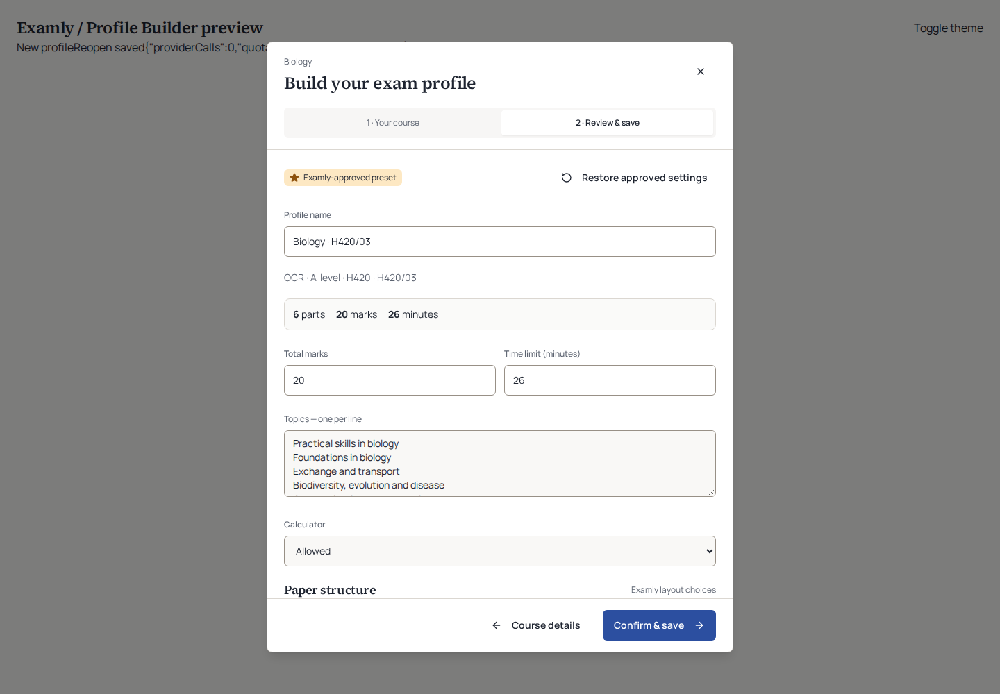
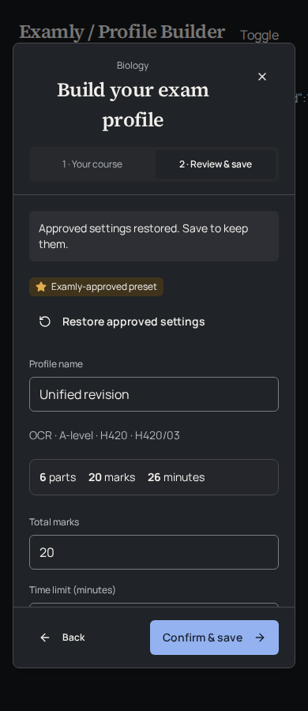

# Implementation verification

Verified on Node 24.19.0 using the repository lockfile. The only dependency change is the pinned `unpdf@1.8.1` text parser and its lockfile entry. Generated Supabase types and protected environment files were not edited.

| Check | Actual result |
| --- | --- |
| `npm ci` | Passed; 864 packages installed |
| `npm run check` | Passed |
| Frontend typecheck | Passed |
| Critical React hook checks | Passed |
| Vitest | 1,944 passed across 119 files; no failures |
| Edge identifier check | Passed, including shared modules |
| Function bundling | 39 functions bundled |
| Production build | Passed |
| `node scripts/audit-biology.mjs` | 52 existing combinations checked; no defects |
| `node scripts/audit-profile-coverage.mjs --json` | All 52 immutable approval/pending records passed fingerprints/ledger checks |
| `git diff --check` | Passed |

The pre-change baseline had 1,771 tests. The 173 additional checks cover the approval ledger and exact matching, compiler/choice totals, evidence references and contradictions, uploads/parser bounds and cleanup, source fetch security, proposal quotas/idempotency, protected SQL persistence, actual backend handlers and the actual builder UI. Existing contract fingerprints remain unchanged.

## What the tests execute

- The SQL suite executes the **actual pending SQL** inside an in-process Postgres/PGlite with controlled stand-ins for the existing application schema. It verifies forged marker insert/update/clear rejection, ordinary owner edits, service-only writes/RPC grants, owner isolation, numeric accounting, replay limits and concurrent confirm producing one profile. It is not a rehearsal against the connected Supabase instance or a restorable production snapshot.
- Backend handler tests execute `profile-builder`, existing exam extraction/publication, and both practice handlers with controlled provider/database/network fixtures. A saved template dictates actual question numbers, topic scope and total marks. Missing mandatory resources remain blocked. Practice retains quiz shape and never accesses global builder caches.
- Existing course/marking/mastery regressions run with the normal suite. No new answer storage or analytics engine is introduced. This does not prove real provider science, every unfamiliar curriculum rule or a complete live marking/analytics round trip.
- URL/DNS/redirect/socket and malicious document cases use controlled fixtures. The repository refresh command was **not** run against live sources as an automated-test dependency.

## Chromium interactions

The real builder/editor components and real compiler/proposal service were exercised in Chromium using an explicit temporary test view. Provider responses were synthetic and saves were **browser memory only**. The temporary entry files were removed before final typecheck/build. There is no production fixture route, authentication bypass or public test data switch.

[Machine-readable browser report](browser-verification.json) records 17 successful checks:

1. Exact approved OCR H420/03 preset returns its real contract and a gold star.
2. Star meaning is focusable by keyboard and available in accessible text.
3. Catalogue resolution makes zero model calls and zero quota reservations.
4. Editing generation settings removes approval; explicit restore recovers it.
5. Rename, confirm and reopen retain settings in browser memory.
6. Invalid total marks disable saving.
7. Desktop 1440 px, tablet 768 px and mobile 390 px fit in both themes; footer actions remain inside the dialog.
8. Registered Pearson evidence produces an editable synthetic source-backed draft with no star.
9. A private university brief produces an institution-scoped draft, saves and reopens in memory; embedded approval instructions do not grant a star.
10. Explicit unverified practice is labelled honestly; full mock is blocked; cancelling does not save.
11. The existing manual editor still opens.

No JavaScript, console or resource errors occurred in the final controlled run. Manrope and Source Serif 4 loaded from actual Google font files cached for the test: direct Chromium font requests were blocked by this environment's networking, while system HTTPS fetched the resources with normal TLS verification. This does **not** certify direct Google Fonts networking in deployment. TLS verification and normal browser web-security checks were not disabled.

## Remaining checks and warnings

No live database save/reopen, live function deployment, real paid model output, scientific/distractor assessment, full live marking/mastery cycle or browser-exported generated exam PDF was performed. Existing cover/review/PDF label paths consume the saved context and are covered by code regressions; a real downstream PDF remains a deliberate post-rollout check.

Nonblocking warnings were recorded without disabling checks: deprecated packages, npm's environment `http-proxy` warning, stale Browserslist data, existing React DOM-nesting warnings in tests, ambiguous Tailwind duration and large Vite chunks. The synthetic PDF extraction test also emits the parser's missing `standardFontDataUrl` warning; text extraction passes and external font fetching remains disabled. The temporary browser harness used Vite's deprecated CJS Node API; that harness is not shipped.

Passing these checks establishes implementation behaviour against controlled cases. It does not establish a 10/10 paper, board endorsement or universal curriculum accuracy. The founder's Gemini review stays external.
