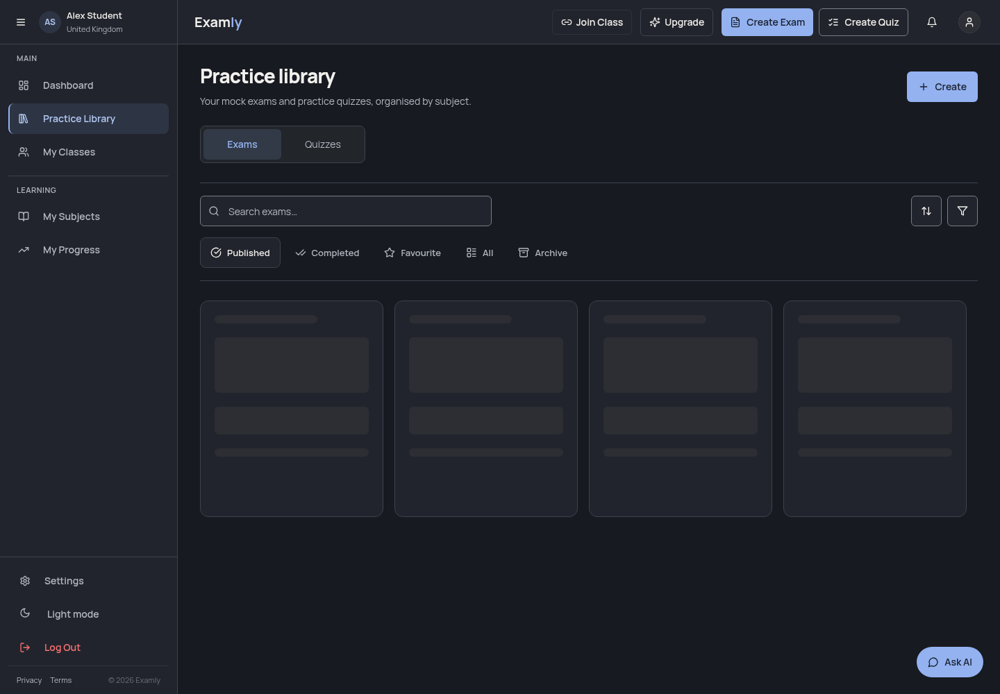
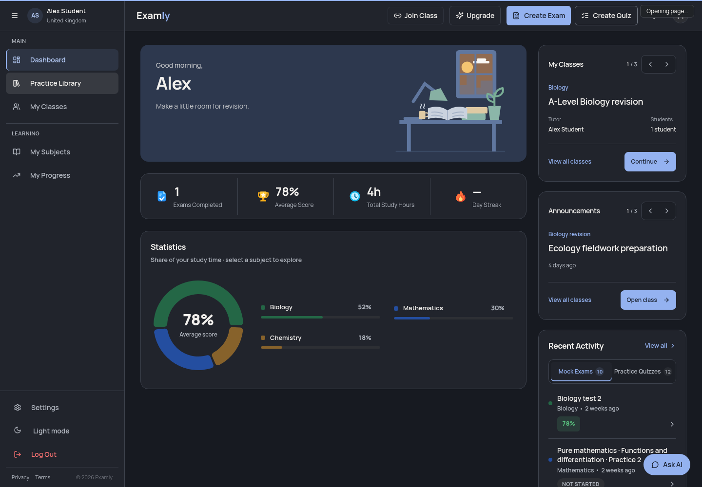

# Smooth workspace navigation

## What changed

The old route-level Suspense boundary replaced entire pages during dynamic imports. Each page also restarted independent role, subject, profile and analytics reads. Classes loaded dependent and independent data sequentially. This made even return visits show empty loading cards.

`WorkspaceRouteViewport` defers the rendered location: the current committed screen remains visible while the selected destination's code and read-only metadata load. A small accessible status reports the pending transition. Browser history still belongs to React Router. The latest navigation wins; there is no custom gesture or artificial delay. First direct entry still has an honest loading state.

`WorkspacePageReady` prepares only the clicked route's existing data. It does not mount destination forms, fetch answer keys, recover drafts, publish work, generate content or invoke a model. Loading failures become retryable; independent widgets retain their own error and retry controls while the rest of the page stays usable. Stalled metadata reads time out. Existing page-level exam access checks remain in place.

Shared read queries use the existing React Query dependency in a memory-only cache attached to one account and sign-in generation. Role, subject, profile, class and analytics consumers deduplicate requests and retain snapshots during refresh. Returning to subject accuracy refreshes its value in the background so newly marked practice is reflected promptly. Stats and class reads run independently where their inputs permit. Existing formulas and filters are retained. Confirmed mutations cancel stale reads before updating cached data; library revisions prevent deleted or archived items from returning. Draft recovery remains in the opened library and invalidates prepared data after confirmed restoration.

The viewport and read cache reset immediately when the account changes or signs out. Older Home/sidebar summaries in the application cache are also removed. This includes signing out and back in as the same person. A verified account mismatch fails before scoped reads. These caches do not replace server permissions, ownership or release controls.

Code prefetch supports sidebar hover, keyboard focus and mobile pointer input. It loads modules only. No query, publication or generation happens because a navigation item is hovered.

## Verification boundaries

Browser comparisons use the real App and lazy route chunks with a synthetic Supabase SDK fixture; all real backend/model requests are blocked. The same data and controlled network delays are used for the main baseline and feature branch. Timings from this harness describe that fixture only, not production speed guarantees. Chromium responsive emulation is not real iOS/iPadOS testing.

No dependencies, lockfile, backend functions, schema, authentication settings, exam generation, marking or score formulas changed. No deployment, migration, live data mutation, paid generation or real account login is part of verification.

## Browser evidence (21 October 2026)

Baseline: `0c6391a2d049c6f3e20a9dd6a2fc34e929aaa56a` (PR #39 on main). Actual App bundles retain lazy splitting in both builds. SDK fixtures use identical synthetic data with 120 ms authentication and 180 ms read delays. No live account, backend or model call is used.

Chromium checked first and repeat visits through Home, Exams, Quizzes, Subjects, Stats, Classes and Settings at 390×844, 834×1112, 1112×834 and 1440×1000 in light and dark mode: 112 transitions per build. The final build had zero sampled loading-card, full-page-skeleton or empty frames during those transitions. It had no horizontal overflow, JavaScript/console errors, failed requests or certificate errors. Google fonts loaded with verified TLS. A temporary isolated certificate database was used; the persistent trust/key store was masked and unchanged.

Twelve further scenarios passed, including cold optional-widget failures with independent retries and canceling a pending mobile tab by tapping Home. The other scenarios cover: direct-entry failure/retry; a cold Home visit after direct library entry; retaining Home on a slow sidebar transition; Back during pending navigation; actual Exams/Quizzes controls with Back/Forward and restored search; rapid navigation; retaining Stats on failed background refresh and retry; mobile primary tabs/reselection with reduced motion.

Controlled-fixture timings include an 80 ms settling period and describe shared-machine fixture evidence, not a live performance promise. See [comparison results](navigation-evidence/browser-summary.json) and [scenario results](navigation-evidence/browser-scenarios.json).

At the same point during a slow navigation:

| Before | After |
| --- | --- |
|  |  |

Responsive samples: [phone library](navigation-evidence/mobile-library.png), [tablet portrait](navigation-evidence/tablet-home.png), [tablet landscape](navigation-evidence/tablet-landscape.png).

Real iOS/iPadOS hardware, live Supabase latency and real account workflows remain unverified. First direct loads retain honest loading/error states. Assessment items, profile-detail widgets and creation workflows keep their own item-specific access, resource and form-loading behavior; they are not speculatively mounted or generated by navigation.

## Repository checks

Node 24.19.0, unchanged `package-lock.json` and dependency versions:

- `npm ci`: passed using the existing writable `/workspace/.npm-cache` (`npm_config_cache` override). The first attempt used the sandbox's unwritable default home cache and was replaced by this successful verified install.
- `npm run check`: its default-worker test phase passed 2,206 assertions but returned failure because Vitest reported two `onTaskUpdate` worker RPC timeouts. This was not recorded as a clean check.
- The complete check sequence was rerun successfully with a single test worker: `npm run typecheck && npm run lint:critical && npm test -- --maxWorkers=1 && npm run check:edge && npm run build`. No test timeout, assertion, baseline hash or validation rule was relaxed.
- Final typecheck, critical lint and six affected test files were rerun after the last widget/error changes: 66 tests passed, including 29 shared-data, 15 navigation, five library-race and 17 existing Stats/profile regression cases.
- `git diff --check` and staged whitespace checks passed.

Existing warnings include the old Browserslist database, third-party Zod PURE-comment annotations and Vite bundle-size warnings. Existing exam-dialog DOM-nesting and PDF-font fixture warnings also appear in the broader test suite; those files are unchanged. The tested workspace browser flows produced no console warnings/errors.

No Edge Function deployment or migration is required. This is a frontend change. Keep the PR in draft and the website unpublished until review.

Final mobile safety verification also passed: typecheck, critical lint, 50 existing mobile tests plus 16 route tests, and the production build. The new mobile case cancels a pending destination when the user taps the still-visible Home tab; ordinary tab reselection still scrolls to the top.

One external Google Fonts HTTP 503 occurred in the first final matrix. Its complete 14-transition viewport was rerun with unchanged source and passed. The [retry record](navigation-evidence/font-retry.json) retains the original failure and clean retry; the final 112-transition record has no browser, request or certificate errors. TLS verification stayed enabled throughout.

Confirmed Account saves also ignore intentional cancellation of an older refresh; a stale-read race test verifies the saved name remains and no false refresh error appears. Final typecheck, critical lint and all 29 shared-data tests passed for this case.
