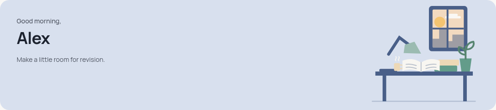
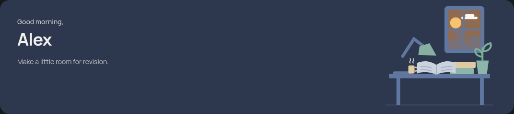
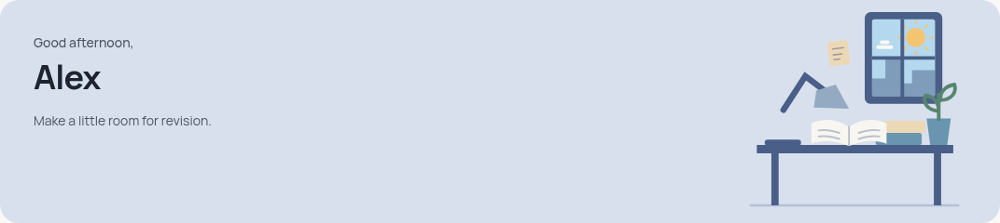
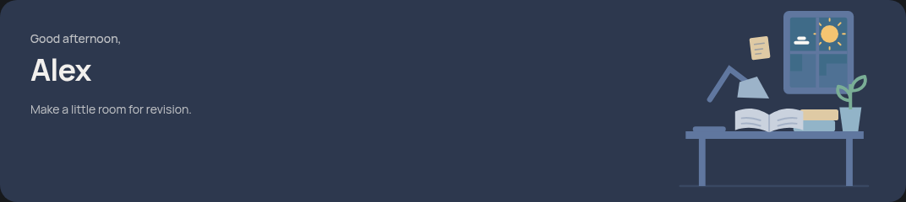
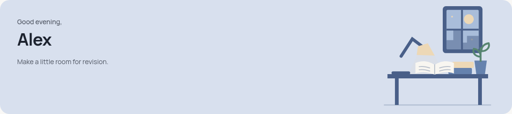
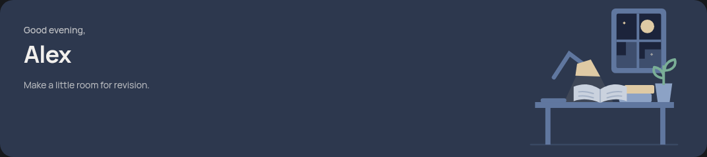

# Responsive study welcome banner

The original mobile desk, lamp, book, plant and window now form one shared
`StudyWelcomeBanner` on student Home at mobile, iPad and laptop widths. The
larger layout places the banner above both dashboard columns; existing create
actions, classes, activity, profile statistics and navigation retain their data
and callbacks. The loading skeleton reserves the new banner space.

Three original SVG settings follow the existing device-local greeting boundaries:

| Setting | Local time | Details |
| --- | --- | --- |
| Morning | Before 12:00 | Warm sky, low sun, cloud, mug and an unlit lamp |
| Afternoon | 12:00–17:59 | Blue sky, sun rays, a small note and an unlit lamp |
| Evening | From 18:00 | The familiar moon, a few stars and warm lamplight |

The greeting and scene use the same period state. A single timer updates at the
next boundary, with focus/visibility refresh after a sleeping tab. Timers and
listeners are removed on unmount. This adds no network request, stored preference
or model call. The art is decorative and hidden from assistive technology, with
no animation. The hero background and top-bar continuity on mobile are retained
in both themes. The four-segment mobile stats strip remains 58px tall, with
20px icons and no visible labels.

## Preview gallery

These screenshots show the actual dashboard with an in-memory fixture session,
not a real student's account. All live Supabase requests were blocked; the
notification endpoint was also replaced with a read-only local fixture.

| Setting | Light | Dark |
| --- | --- | --- |
| Morning |  |  |
| Afternoon |  |  |
| Evening |  |  |

Full dashboard screenshots: [mobile, 390px](mobile-dark.png),
[iPad portrait, 834px](ipad-dark.png), [laptop, 1440px](laptop-light.png).

## Verification

Node 24.19.0, existing installed dependencies and unchanged lockfile:

- `npm run typecheck`: passed.
- `npm run lint:critical`: passed.
- `npx vitest run src/test/study-welcome-banner.test.tsx src/test/mobile-home.test.tsx --maxWorkers=1`: **15 tests passed in 2 files**. Nine new cases cover local time boundaries, live noon/evening/midnight updates, returning to a sleeping tab, decorative artwork and cleanup. Six existing mobile Home cases cover retained statistics and actions.
- `npm run build`: passed.
- `git diff --check`: passed.

Chromium exercised all three settings at **320, 390, 600, 768, 834, 1024, 1194
and 1440px** in light and dark themes, using a Europe/London clock at 09:00,
14:00 and 20:00. The 48 views check one shared banner, matching scene/greeting,
artwork/text separation, contained artwork, no horizontal page overflow, retained
create controls and the unchanged compact mobile stats strip. Long-name overflow
was additionally checked at 320, 600 and 834px.

Final browser checks recorded no JavaScript, console, certificate or request
failures, Google Fonts responses were HTTP 200, and there were zero live backend
requests. Initial preview setup needed the saved Start skill's verified managed
proxy CA initialization and complete notification fixtures. Normal TLS validation
remained enabled; no application environment settings or credentials changed.

Existing production-build warnings remain: outdated Browserslist data, a Zod
comment annotation and chunks above 500kB. The full repository test suite and
Edge Function bundles were not rerun for this frontend-only change. Physical
iOS/iPadOS hardware and a real authenticated account remain unverified; viewport
emulation does not establish real-device behaviour.

No dependencies, backend functions, schemas, assessment contracts, exam generation,
marking or live data changed. No migration, function deployment or website
publication is needed or performed. Review the draft PR and use **Squash and
merge** after CI passes.
